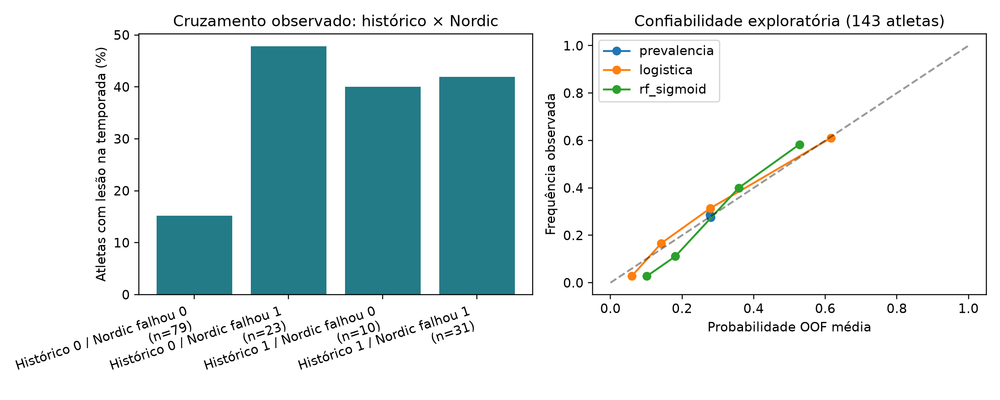
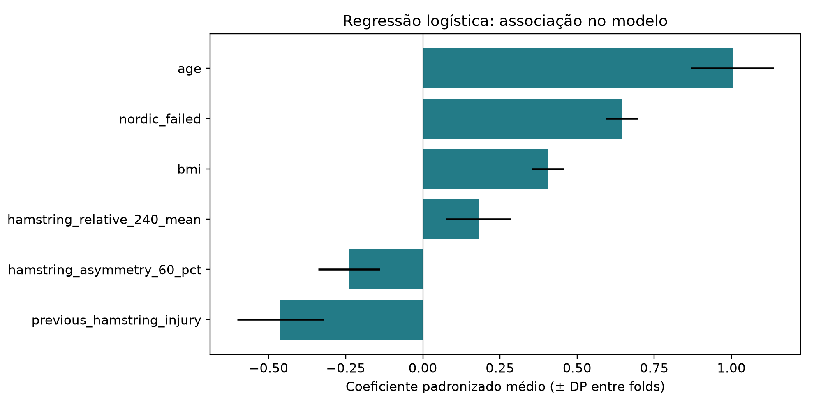

# Shalaj: testes de pré-temporada e lesão de isquiotibiais

**Status:** suplemento público baixado e inspecionado; cruzamento por atleta executado. A validação é interna e exploratória, para ocorrência na temporada. A base não permite construir o desfecho de sete dias do modelo teórico.

## Origem e acesso

- Shalaj et al. (2020), *Potential prognostic factors for hamstring muscle injury in elite male soccer players: A prospective study*. [Artigo](https://doi.org/10.1371/journal.pone.0241127).
- [Suplemento S1, SPSS SAV](https://journals.plos.org/plosone/article/file?type=supplementary&id=10.1371/journal.pone.0241127.s001).
- Coorte de homens da primeira divisão de Kosovo, temporada 2013/2014, 11 clubes segundo o artigo. Avaliações anteriores ao início da temporada e acompanhamento pelos profissionais de saúde dos clubes.
- Download público sem credenciais. O arquivo original permanece em `data/raw/`, ignorado pelo Git. URL, hash SHA-256 e tamanho da amostra estão em [summary.json](results/summary.json).

## Inspeção e validade do desfecho

O suplemento tem **143 linhas, 49 colunas e 143 `player_id` distintos**. Há uma célula ausente, em `Relative_Quadriceps_torque_240_nondom`, variável que não entra no modelo. Nomes, descrições e códigos de todas as colunas foram preservados no [dicionário extraído do SPSS](results/data_dictionary.json).

O nome `total_hamstring_injuries` pode induzir a erro: **não é uma contagem de episódios**. Seus rótulos SPSS são `1 = yes` e `2 = no`. O alvo é `(total_hamstring_injuries == 1)`, correspondendo a **40 atletas com lesão e 103 sem lesão**. Os **43 episódios** relatados no artigo não devem ser tratados como 43 atletas ou como linhas independentes.

Não há datas individuais de início dos episódios, identificadores de clube, série diária de carga, sono ou HRV no suplemento. Assim, ele é adequado para associações entre características iniciais e lesão na temporada; não para alertas diários, ACWR ou previsão de nova lesão nos próximos sete dias.

## Cruzamento executado

Cada linha já contém a avaliação e o desfecho do mesmo atleta. `player_id` é a chave de unicidade; não se juntam atletas de outras bases. Foram derivados:

| Atributo | Construção e momento |
|---|---|
| Idade e IMC | `age`, `bmi`, avaliados na pré-temporada. |
| Histórico anterior | `previous_hamstring_injury`: `0 = no`, `1 = yes`. |
| Falha no Nordic | `nordic_hamstring_test == 2`; SPSS `1 = yes`, `2 = no`, interpretado como passar/não passar conforme o protocolo do artigo. |
| Torque relativo médio a 240°/s | Média do torque concêntrico dos isquiotibiais dominante e não dominante, dividida pela massa corporal (Nm/kg). A grafia original `hamsrings_concentric_240_nondom` foi mantida na leitura. |
| Assimetria a 60°/s | `100 × abs(dominante − não dominante) / max(dominante, não dominante)`. Definição deste pipeline; não é intercambiável com uma assimetria de outro protocolo. |

O cruzamento compreende correlações de Spearman, tabelas 2×2 com Fisher para variáveis binárias, frequências de lesão por histórico × falha no Nordic e modelos multivariados. Os valores de p são exploratórios, sem correção por multiplicidade, e não estabelecem causalidade.

As seis variáveis são fixadas antes da avaliação; não há seleção com base no desempenho de teste. **Taxas de lesão e exposição acumulada na temporada são excluídas**, pois são informações posteriores à avaliação inicial. O identificador e o próprio desfecho também não entram nos preditores.

## Modelagem e avaliação

- Referência: previsão pela prevalência apenas do treino de cada fold.
- Regressão logística regularizada, com mediana e padronização ajustadas somente no treino.
- Random Forest de 200 árvores, profundidade 3, mínimo de 6 atletas por folha, calibração sigmoidal em três folds internos. A imputação faz parte do pipeline interno.
- Cinco folds externos estratificados, semente 42. Cada atleta recebe uma única previsão **out-of-fold (OOF)** de um modelo que não foi treinado nele.
- ROC-AUC, average precision (AP), Brier e log loss; intervalo bootstrap da AUC com 1.500 reamostragens das previsões OOF. Esse intervalo é condicional às previsões e não representa toda a incerteza de reamostragem e treino.
- Não se escolhe limiar usando o teste; não se produzem faixas clínicas ou recomendações de afastamento. Coeficientes logísticos substituem uma explicação SHAP de um segundo modelo distinto.

Resultados efetivamente calculados estão em [RESULTADOS.md](results/RESULTADOS.md), com a versão estruturada em [summary.json](results/summary.json).

Nesta execução, a regressão logística obteve AUC OOF de **0,8053** e a RF calibrada **0,8235**; a AP da RF foi **0,6266**, frente à prevalência de **0,2797**. A assimetria a 60°/s teve Spearman **−0,065**, sem sustentar neste recorte a associação positiva destacada no SIRP-600. O histórico anterior tem associação marginal positiva (**+0,191**), mas coeficiente logístico ajustado negativo; a inversão entre análise isolada e ajustada impede interpretá-lo como efeito protetor. Não se escolhe um modelo clínico com base nessa comparação interna.





## Reproduzir

Na raiz do repositório:

```powershell
python -m pip install -r shalaj/requirements.txt
python shalaj/pipeline.py
```

O [notebook](shalaj_pipeline.ipynb) inspeciona os dados originais, a matriz de análise e os resultados salvos; executa o pipeline se os resultados estiverem ausentes. Para recalcular explicitamente, execute o comando acima. A exportação processada contém uma linha por atleta, as seis variáveis e o alvo. As previsões OOF e métricas por fold ficam em `data/processed/`.

## Interpretação e relação com o Scout

Esta coorte permite confrontar as hipóteses de histórico e função muscular do SIRP-600 com um desfecho prospectivo específico de isquiotibiais. Protocolos, população e horizonte diferem, portanto não se transferem pesos, probabilidades ou limiares entre bases. Ela não contém sono ou recuperação para testar diretamente a interação carga × recuperação.

O artigo já ressalta a capacidade limitada dos testes de pré-temporada. A amostra é pequena, a validação não separa clubes (identificadores indisponíveis) e não há avaliação externa. Uma boa métrica interna não equivale a utilidade operacional ou validação clínica.

[Voltar ao catálogo Scout](../README.md)
