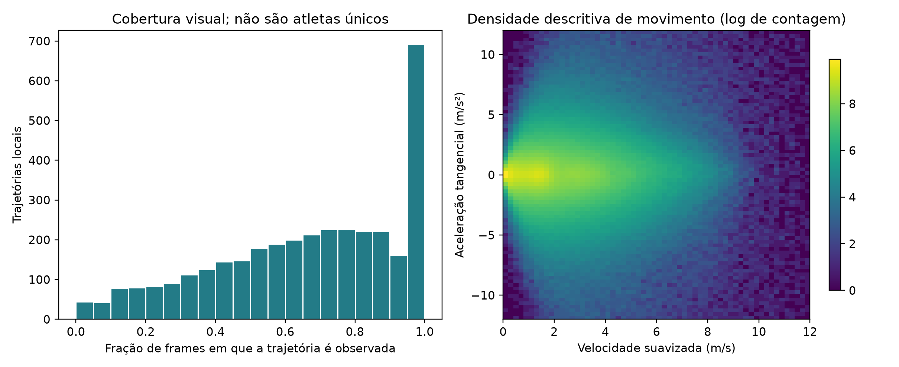
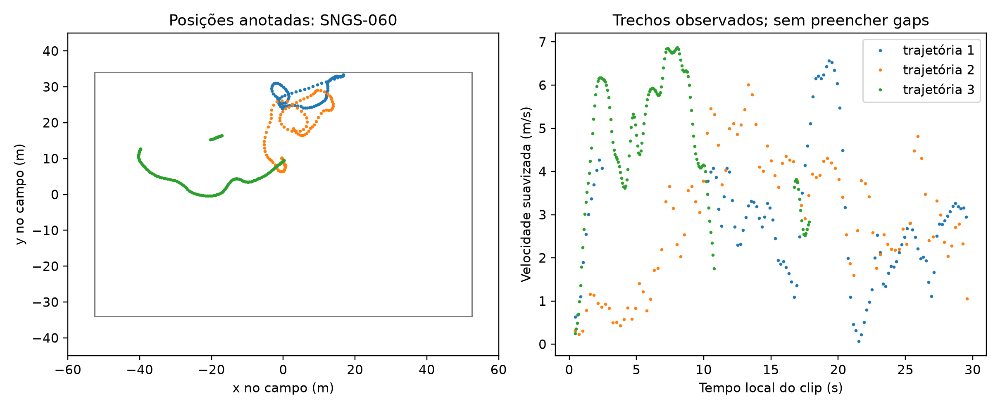

# SoccerNet-GSR: anotações, trajetórias e movimento no campo

**Status: cruzamento cinemático descritivo executado sobre as anotações públicas v1.3. Sem alvo de lesão ou fadiga validada.** Não foi executado um rastreador de vídeo nem reproduzido integralmente o método de Bou.

## Origem e escopo do download

- [Dataset oficial no Hugging Face](https://huggingface.co/datasets/SoccerNet/SN-GSR-2024/tree/main).
- [Descrição oficial da tarefa](https://www.soccer-net.org/tasks/game-state-reconstruction).
- [Devkit oficial e revisão v1.3](https://github.com/SoccerNet/sn-gamestate): a revisão melhora a consistência temporal das posições no campo.
- [Bou et al. (2026)](https://arxiv.org/abs/2604.05636): trabalho que motivou o interesse em indicadores cinemáticos relacionados à fadiga. Ele não é o artigo criador da base.

Foram baixados **todos os membros `Labels-GameState.json` encontrados nos ZIPs públicos de treino, validação e teste**. Os frames de imagem e o split challenge não foram baixados. Os três ZIPs completos somam aproximadamente 29,77 GB; os membros de anotações selecionados somam aproximadamente 525 MB comprimidos dentro dos ZIPs. O acesso seletivo usa HTTP Range, sem baixar e descartar todos os frames.

O [manifesto](results/download_manifest.json) fixa o commit do repositório e registra cada arquivo, split, versão, tamanho, CRC do membro ZIP e SHA-256 do JSON descomprimido. Os JSONs locais são guardados em `data/raw/<split>/<clip>.json.gz`, ignorados pelo Git. A rotina verifica HTTP 206 e o intervalo recebido e rejeita respostas que tentem baixar o ZIP inteiro. A análise verifica novamente o hash de cada JSON.

Nos arquivos inspecionados há **57 anotações de treino, 58 de validação e 49 de teste: 164 clips**. A página da tarefa informa 57/59/50; usamos a contagem dos arquivos efetivamente presentes, sem criar registros para atingir o número anunciado. Todas as anotações utilizadas indicam versão **1.3**.

## Esquema e chaves de cruzamento

| Campo/tabela | Uso |
|---|---|
| `info` | Versão, identificador do jogo e clip, frequência de frames, comprimento da sequência. |
| `images.image_id`, `file_name` | Chave do frame e número sequencial local. Tempo = número do frame / FPS. |
| `annotations.image_id` | Junção com frames, validada como **muitos para um**, sem anotações órfãs. |
| `annotations.track_id` | Identificador de trajetória **local ao clip**, não identidade clínica global. |
| `attributes.role`, `team`, `jersey` | Seleção de jogadores/goleiros, contexto de equipe e número de camisa quando disponível. |
| `bbox_pitch.x_bottom_middle`, `y_bottom_middle` | Posição anotada de referência no plano do campo, em metros. |
| `bbox_pitch_raw` | Posição original também presente na fonte; não usada para trocar silenciosamente a revisão v1.3. |

A chave de uma trajetória processada é **`split + clip + track_id`**. O pipeline verifica unicidade de frame por trajetória, chaves de frames, cobertura e integridade. Não usa apenas o número da camisa para associar jogadores entre jogos ou com registros clínicos de outras bases.

## Cruzamento realizado

1. Carregar cada JSON, verificar seu hash e a versão >= 1.3.
2. Selecionar anotações de jogadores e goleiros com coordenadas finitas; contar ausências de posição.
3. Associar posições ao número do frame por `image_id` e ordenar por trajetória e frame.
4. Registrar posições fora da margem geométrica `|x| <= 60 m`, `|y| <= 45 m`. É uma margem operacional deste pipeline, não um limiar fisiológico.
5. Separar segmentos em qualquer gap de frame, mudança de papel/equipe ou remoção de ponto fora da margem. Não interpolar oclusões nem conectar cortes da transmissão.
6. Em segmentos com pelo menos 22 frames, usar Savitzky-Golay de 11 frames, polinômio de grau 2 e intervalo `1/FPS` para derivar as componentes da velocidade. A velocidade escalar é sua norma; a derivada suavizada dessa velocidade é a aceleração tangencial.
7. Retirar dez frames de cada borda, pois são aplicadas duas operações de janela local. **A suavização usa vizinhos futuros e é exclusivamente retrospectiva**, sem alegação de uso online antes de uma sessão.
8. Marcar como não utilizáveis pontos com velocidade > 12 m/s ou aceleração tangencial absoluta > 12 m/s². Contagens antes/depois são exportadas. Esses limites são controle exploratório da cinemática derivada, não critérios de diagnóstico ou risco.
9. Agregar velocidade média, percentil 95, aceleração absoluta, cobertura e distância observada por trajetória. A distância integra velocidades por trapézios somente em pares de frames adjacentes aceitos. Não extrapola o trecho visível para 30 segundos ou uma partida.

Os dois painéis produzidos mostram cobertura das trajetórias, densidade velocidade × aceleração e exemplos de posições e velocidade local. As frequências são descritivas e não tratam cada frame como atleta independente.

## Resultados e arquivos

Contagens e estatísticas calculadas estão em [RESULTADOS.md](results/RESULTADOS.md) e [summary.json](results/summary.json). Versões de bibliotecas: [environment.json](results/environment.json).

- `data/processed/tracklet_features.csv`: uma linha por trajetória local.
- `data/processed/clip_audit.csv`: contagens, cobertura e controles por clip.
- `data/processed/example_trajectories.csv`: amostra de três trajetórias de um único clip para inspeção visual.
- `data/processed/speed_acceleration_histogram.npy`: contagens agregadas da cinemática aceita.





## Adequação para o Scout

Esta base serve para estudar **extração, associação e qualidade de indicadores de movimento**. Posições anotadas não são medições GPS nem saídas de um modelo executado nesta tarefa. Sem referência cinemática externa, não se reportam erro de velocidade ou acurácia de rastreamento.

O material utilizado não contém sono, HRV, carga diária completa, prontidão medida, rótulo de fadiga ou evento clínico de lesão com data. Portanto:

- Não há modelo de lesão, AUC clínica, calibração de risco ou estimativa de fadiga neste módulo.
- Os clips curtos não permitem acompanhar evolução de fadiga ao longo de uma partida; não se transforma uma relação velocidade × aceleração em um perfil fisiológico validado.
- O jogo adicional de 45 minutos analisado por Bou não foi incluído e sua disponibilidade não é presumida.
- Um futuro cruzamento com prontidão/lesões exigiria dados dos **mesmos jogadores, jogos e instantes**, identidades verificáveis e desfechos correspondentes.

## Reproduzir

Na raiz do Scout, em sequência:

```powershell
python -m pip install -r soccernet_gsr/requirements.txt
python soccernet_gsr/download_annotations.py
python soccernet_gsr/test_kinematics.py
python soccernet_gsr/pipeline.py
```

O download retoma arquivos já registrados e a análise pode rodar offline depois dele. As verificações de cinemática cobrem unidade de velocidade conhecida, ausência de ligação através de gaps e rejeição de anotações sem frame. O [notebook executado](soccernet_gsr_pipeline.ipynb) inspeciona uma fonte real, mostra resultados e verifica as chaves processadas.

[Voltar ao catálogo Scout](../README.md)
