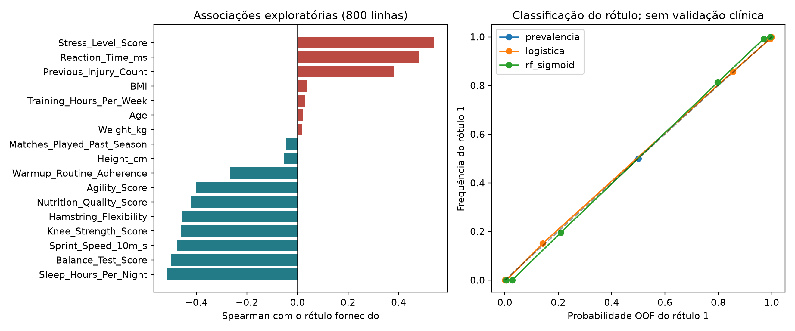
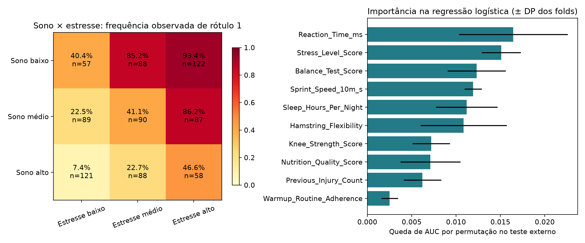

# University Football: rotina, condição física e o rótulo Injury_Next_Season

**Status: download, inspeção e cruzamento exploratório executados. O significado clínico do rótulo não foi validado.** Esta base é utilizável para estudar classificação dos rótulos fornecidos e comparar padrões tabulares; não comprova previsão de lesão real nem sustenta alertas em sete dias.

## Origem, arquivos e rastreabilidade

- [Dataset no Kaggle](https://www.kaggle.com/datasets/yuanchunhong/university-football-injury-prediction-dataset).
- [Ma et al. (2025), Scientific Reports](https://doi.org/10.1038/s41598-025-24144-y).
- Download realizado pelo endpoint público Kaggle, sem credenciais. O ZIP contém `data.csv`. Os metadados do publicador e a descrição foram preservados em `data/raw/`, ignorado pelo Git.
- Hashes do CSV e do ZIP, versão publicada e licença reportada estão em [summary.json](results/summary.json). As versões de bibliotecas da execução estão em [environment.json](results/environment.json).

## O que o arquivo contém

**800 linhas × 19 colunas:** 18 preditores e `Injury_Next_Season`. Não há células ausentes, linhas duplicadas ou vetores de preditores idênticos. São exatamente **400 rótulos 0 e 400 rótulos 1**.

| Dimensão | Colunas |
|---|---|
| Antropometria | `Age`, `Height_cm`, `Weight_kg`, `BMI` |
| Exposição e histórico | `Position`, `Training_Hours_Per_Week`, `Matches_Played_Past_Season`, `Previous_Injury_Count` |
| Condição física | `Knee_Strength_Score`, `Hamstring_Flexibility`, `Reaction_Time_ms`, `Balance_Test_Score`, `Sprint_Speed_10m_s`, `Agility_Score` |
| Rotina | `Sleep_Hours_Per_Night`, `Stress_Level_Score`, `Nutrition_Quality_Score`, `Warmup_Routine_Adherence` |

O [dicionário inspecionado](results/data_dictionary.json) registra tipos, amplitudes, cardinalidades e ausências. O IMC foi recalculado a partir de massa e estatura e confere com o arquivo, dentro da precisão numérica.

Não há identificador de atleta, clube, data de avaliação, data de lesão, diagnóstico anatômico ou log diário. `row_id`, nas exportações deste módulo, é somente a posição da linha no CSV; não é uma identidade clínica verificada.

## Auditoria de adequação

1. **Desfecho inconsistente nas fontes.** A descrição Kaggle fala em lesão que cause ao menos sete dias de ausência. O artigo tem uma definição de lesão observada e outra de classificação de alto risco com avaliação médica e de treinadores. Não é possível determinar pelo CSV se o alvo foi observado, avaliado ou gerado. O artigo também afirma, em *Dataset source and description*, que os dados não são de uma coorte clínica prospectiva real, embora outras passagens descrevam acompanhamento prospectivo. Essas alegações conflitantes foram mantidas como incerteza de proveniência.
2. **Escala de estresse.** O artigo descreve PSS-10 de 0 a 40. No CSV, **715 de 800** valores excedem 40, com amplitude aproximada de 21,56 a 87,07. O pipeline mantém o escore publicado; não o renomeia como PSS-10 nem inventa uma transformação.
3. **Sprint.** `Sprint_Speed_10m_s` varia de aproximadamente 4,86 a 6,90. O nome mistura velocidade e segundos, e seu sentido de associação requer esclarecer a unidade. Não é convertido para m/s ou interpretado como um limiar fisiológico.
4. **Ausência de datas e identidade.** A unidade informada pelo publicador é uma pessoa por linha, mas essa unicidade de pessoa não pode ser auditada sem identificadores. Não se calcula ACWR nem se cria uma série temporal artificial.
5. **Proporção 50/50.** É a frequência dos rótulos da base, não uma estimativa da incidência real de lesões. Calibração interna não torna probabilidades transferíveis a um clube.

Consequentemente, todos os resultados abaixo se referem ao **rótulo 1 fornecido**, e não a uma probabilidade clínica individual de lesão.

## Cruzamento e validação executados

Os 18 atributos já pertencem à mesma linha. Não há junção com atletas do SIRP-600, SoccerMon ou outra coorte. O cruzamento inclui:

- Spearman entre os 17 atributos numéricos e o rótulo.
- Frequências observadas do rótulo em nove combinações de tercis de sono × estresse, com contagem de linhas por célula. Os tercis são descritivos e não faixas clínicas.
- Referência pela prevalência, regressão logística regularizada e Random Forest de 200 árvores, profundidade 5 e mínimo de 5 linhas por folha, calibrada por sigmoid em três folds internos.
- Cinco folds externos estratificados, semente 42. Cada linha recebe uma previsão OOF. Imputação, padronização, one-hot e calibração são ajustados nos respectivos treinos, incluindo os folds internos da RF.
- ROC-AUC, average precision, Brier, log loss e IC bootstrap condicional da AUC com 1.000 reamostragens. Não há busca de hiperparâmetros ou limiar no teste.
- Importância por permutação dos atributos originais na regressão logística, usando somente a parte de teste de cada fold. A queda de AUC mede dependência do modelo e não causalidade; variáveis correlacionadas podem dividir sua importância.

Essa análise reproduz o procedimento de cruzamento do Scout com salvaguardas explícitas; não é uma reprodução exata dos dez algoritmos e da seleção do artigo de Ma.

## Resultados

Veja [RESULTADOS.md](results/RESULTADOS.md) e [summary.json](results/summary.json) para os números efetivamente executados. Não se escolhe um modelo para uso clínico com base nessa comparação.

Na execução OOF, a logística obteve **ROC-AUC 0,9900 / AP 0,9901 / Brier 0,0389** e a RF calibrada **ROC-AUC 0,9845 / AP 0,9843 / Brier 0,0473**. Sono (**Spearman −0,516**) e estresse (**+0,540**) apresentam associações fortes com o rótulo. A alta separabilidade dos rótulos não resolve sua construção ou a proveniência clínica. A frequência do rótulo 1 varia de **7,4%** no tercil de sono alto × estresse baixo a **93,4%** no tercil de sono baixo × estresse alto; esses são cruzamentos descritivos da própria tabela, sem efeito causal demonstrado.





## Reproduzir

Na raiz:

```powershell
python -m pip install -r university_football/requirements.txt
python university_football/pipeline.py
```

O [notebook executado](university_football_pipeline.ipynb) apresenta inspeção, auditoria e resultados salvos; executa o pipeline quando os resultados estão ausentes. As previsões OOF, métricas por fold, tabela de tercis e importâncias ficam em `data/processed/`. Nenhum registro é substituído por simulação.

## Relação com os estudos existentes

Sono, estresse, histórico e aquecimento permitem comparar **padrões de associação** com SIRP-600 e Multimodal Injury. A semelhança das variáveis ou de suas correlações não comprova que sejam medidas na mesma escala, nem que os rótulos tenham o mesmo significado. Esta base não deve ser usada como validação clínica externa daqueles modelos até que a origem e a construção do desfecho sejam esclarecidas.

[Voltar ao catálogo Scout](../README.md)
